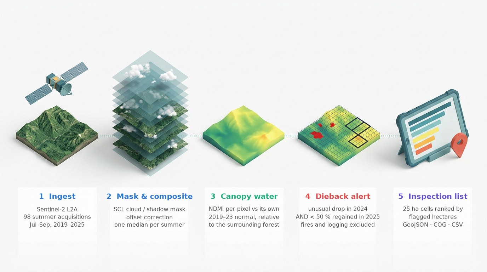

# Post-drought forest dieback in Sardinia: where should foresters inspect first?

Earth Observation AI Engineer: home assignment. Everything is in [`notebook.ipynb`](notebook.ipynb), executed top to bottom.

In August 2024 the Sardinian Regional Government declared urgent measures against a dieback of cork-oak and holm-oak woods spreading over thousands of hectares ([Delibera RAS n. 31/7, 28.08.2024](https://delibere.regione.sardegna.it/protected/71682/0/def/ref/DBR71680/)). This project tells the regional forest agency where to send field teams first in the Sette Fratelli massif.

> **Answer in brief.** Summer 2024 was by far the driest canopy state of 2019–2025. **2,211 ha (13 % of the analysed forest) dried out much more than the surrounding woods and had not recovered by summer 2025**, after excluding fires and clear-cuts. They concentrate in **40 blocks of 25 ha**, ranked in [`outputs/alert_cells.csv`](outputs/alert_cells.csv) / [`.geojson`](outputs/alert_cells.geojson).



*Illustrative render with labels, not to scale; each step is a function in `src/pipeline.py` and a section of the notebook.*

## Choices

| | |
|---|---|
| Use case | Forest dieback after the 2024 drought in Sardinia (Sette Fratelli massif, Sarrabus) |
| Decision question | Which forest areas should the regional forest service inspect first: canopy that dried out in summer 2024 **and did not recover** in 2025? |
| AOI and time range | `(9.33, 39.19, 9.52, 39.33)`, July–September 2019–2025 |
| Data | Sentinel-2 L2A (98 acquisitions), ESA WorldCover 2021 |
| Backend | Microsoft Planetary Computer, STAC API (no account needed) |
| Indices | NDMI (main), NDVI, CRswir, NBR (fire / logging screen) |
| Foundation models (bonus B) | TerraMind 1.0 base, run locally (generated land cover, embeddings); TESSERA v1 pre-computed embeddings |

## Outputs (`outputs/`)

| File | What |
|---|---|
| `composites_true_false_colour_2023_2025.png` | True- and false-colour summer composites |
| `timeseries_ndmi_ndvi.png` | NDMI and NDVI per acquisition, 2019–2025 |
| `ndmi_z2024.tif`, `ndmi_recovery2025.tif`, `dieback_alert.tif` | Cloud-Optimised GeoTIFFs, EPSG:32632, 20 m |
| `alert_cells.geojson`, `alert_patches.geojson` | Priority 25 ha cells and flagged patches (EPSG:4326) |
| `alert_cells.csv` | Ranked inspection list |
| `anomaly_recovery_flag.png` | Anomaly, recovery and alert maps |
| `priority_cells_true_colour.png` | Top-3 priority cells in true colour, 2023–2025 |
| `terramind_lulc_2023_2025.png`, `terramind_embedding_change.png` | Bonus B: TerraMind generated land cover and embedding change |
| `tessera_clusters_alert_rate.png` | Bonus B: TESSERA forest types and alert rate |

## Bonus B: what geospatial foundation models add (notebook section 9)

- **TerraMind 1.0 base** (IBM, ESA, Jülich), **run locally** on 12-band 10 m composites:
  - its generated land cover agrees with the real ESRI / IO 2023 map on 88.6 % of pixels;
  - a new column of the inspection list, `canopy_no_longer_trees`, gives the share of flagged tree canopy that no longer looks like trees in 2025, to separate "monitor" from "plan restoration";
  - its embeddings change most where NDMI flags.
- **TESSERA** pre-computed embeddings:
  - whole-year change confirms the alerts (Spearman 0.68 at cell level);
  - unsupervised forest types show that alerts concentrate in some types and almost spare others.

## Bonus A: the pipeline as MCP tools, called by EVE


*Real terminal recording (`figures/mcp_eve_demo.cast`): EVE-Instruct, running locally, answers the example question of the assignment by calling `compare_vegetation`; the pipeline runs on fresh Sentinel-2 data and the answer passes the grounding check.*

- `mcp_server/server.py`: MCP server (FastMCP, stdio) with three tools: `list_scenes`, `compare_vegetation`, `dieback_alerts`.
- `mcp_server/agent.py`: LangGraph agent; EVE-Instruct (`eve-esa/EVE-Instruct-GGUF-Q4_K_M`) runs locally via Ollama and calls the tools; each run writes a transcript with an automatic grounding check.
- `outputs/mcp/transcript_q*.md`: the three demonstration questions (example question of the assignment, our use case, an out-of-scope question). Earlier runs, with the errors they revealed, are in `outputs/mcp/run1/` and `run2/`.

```bash
pytest -q                                # works without any LLM: real MCP server + agent wiring with a scripted fake model
ollama pull hf.co/eve-esa/EVE-Instruct-GGUF-Q4_K_M
python -m mcp_server.demo_questions      # the three questions with EVE
python -m mcp_server.agent --model qwen2.5:7b-instruct "..."   # any Ollama model with tool calling
```

## Repository layout

- `notebook.ipynb`: narrated analysis, all cells executed.
- `src/pipeline.py`: all processing functions (search, masking, indices, composites, anomaly / recovery, aggregation, export). The notebook and the MCP server call them.
- `src/gfm.py`: TerraMind and TESSERA (bonus B).
- `mcp_server/`, `tests/`: bonus A.
- `figures/`: method diagrams and illustrations used in the notebook.
- `outputs/`: generated files.
- `data/` (not versioned): cache of TESSERA embeddings.

## Run it

Python 3.12. EVE / Ollama are optional: without them, section 10 shows the transcripts of the last live run and says so.

```bash
python3 -m venv .venv && source .venv/bin/activate
pip install -r requirements.txt
jupyter lab notebook.ipynb   # or: jupyter nbconvert --to notebook --execute notebook.ipynb
```

A full run takes about 20 minutes on a laptop CPU: Sentinel-2 windows for seven summers, 12-band 10 m composites for TerraMind, and about 1.7 GB of TESSERA embeddings on first run (cached in `data/`).

## Notes

Developed with AI coding assistance, as the assignment allows. The use case, the methodological choices and the results were reviewed by me, and I will explain them in the interview.
