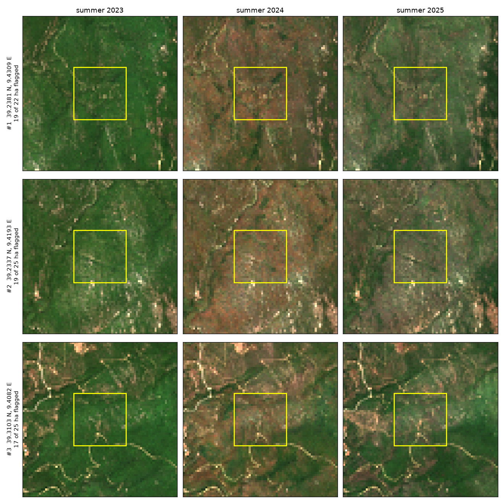

<div align="center">

# 🌳 Sardinia Forest Dieback EO

**Which forest stands should field teams inspect first after the 2024 drought?**
Sentinel-2 time series, geospatial foundation models and an MCP agent powered by EVE.

[](https://github.com/bitwiseops/sardinia-forest-dieback-eo/actions/workflows/tests.yml)

[](LICENSE)


*From 98 Sentinel-2 acquisitions to a ranked inspection list (illustrative render).*

</div>

---

## Table of contents

- [Overview](#overview)
- [Highlights](#highlights)
- [Quick start](#quick-start)
- [Results](#results)
- [How it works](#how-it-works)
- [Foundation models (TerraMind, TESSERA)](#foundation-models-terramind-tessera)
- [Agent: the pipeline as MCP tools, called by EVE](#agent-the-pipeline-as-mcp-tools-called-by-eve)
- [Project structure](#project-structure)
- [Reproducibility](#reproducibility)
- [Limitations](#limitations)
- [References and acknowledgements](#references-and-acknowledgements)
- [License](#license)

## Overview

In August 2024 the Sardinian Regional Government declared urgent measures against a dieback of cork-oak and holm-oak woods and Mediterranean scrub, spreading over thousands of hectares, and charged the regional forest agency FoReSTAS with monitoring and response ([Delibera RAS n. 31/7, 28.08.2024](https://delibere.regione.sardegna.it/protected/71682/0/def/ref/DBR71680/)).

This project answers the question a forest manager has to settle before sending teams out: **which forest areas in the Sette Fratelli massif (Sarrabus, SE Sardinia) dried out in summer 2024 *and did not recover* in 2025?** In a drought year almost every crown loses water. The stands that fail to recover the following year are the ones at risk of dieback and mortality.

> **Answer in brief.** Summer 2024 was by far the driest canopy state of 2019–2025. **2,211 ha (13 % of the analysed forest) dried out much more than the surrounding woods and had not recovered by summer 2025**, after excluding fires and clear-cuts. They concentrate in **40 blocks of 25 ha**, ranked in [`outputs/alert_cells.csv`](outputs/alert_cells.csv) / [`.geojson`](outputs/alert_cells.geojson).

Everything is in [`notebook.ipynb`](notebook.ipynb), narrated and executed top to bottom.

## Highlights

- 🛰️ **Real pixels, no account:** 98 Sentinel-2 L2A acquisitions (July–September 2019–2025) streamed from Planetary Computer via STAC.
- 🧹 **Careful preprocessing:** processing-baseline offset correction, SCL cloud/shadow whitelist, per-summer median composites on the native 20 m UTM grid.
- 💧 **Decision rule:** a landscape-relative NDMI anomaly in 2024 **and** less than 50 % recovery in 2025. Fires and logging are screened out with NBR step changes. Threshold sensitivity is reported.
- 🗺️ **Decision-ready outputs:** ranked 25 ha cells (CSV, GeoJSON), Cloud-Optimised GeoTIFFs, an interactive folium map, and a plain-language summary generated from the numbers.
- 🧠 **Foundation models:** TerraMind 1.0 **run locally** (generated land cover, embeddings) and TESSERA embeddings add what band math cannot tell.
- 🤖 **Agentic:** the same pipeline exposed as **MCP tools** and called by **EVE-Instruct**, running locally, through a LangGraph agent. Each answer is checked automatically against the tool outputs.
- ✅ **Tested:** `pytest` runs the real MCP server and the agent wiring in CI, no LLM required.

## Quick start

Requires Python 3.12 with the `venv` module (on Ubuntu/Debian: `sudo apt install python3.12-venv`, or create the environment with pyenv or uv).

```bash
git clone https://github.com/bitwiseops/sardinia-forest-dieback-eo.git
cd sardinia-forest-dieback-eo
python3.12 -m venv .venv && source .venv/bin/activate
pip install -r requirements.txt

jupyter lab notebook.ipynb                     # the full analysis (mostly downloads, so time depends on your network)
pytest -q                                      # MCP server + agent wiring, no LLM needed
```

Optional, to run the agent with EVE (14 GB model). It needs a recent [Ollama](https://ollama.com/download) (tested with 0.40.6): with older releases (tested: 0.23.0) the EVE model is registered without tool support and the agent stops with `does not support tools`. Check with `ollama --version`.

```bash
ollama pull hf.co/eve-esa/EVE-Instruct-GGUF-Q4_K_M
python -m mcp_server.agent --live "After the 2024 drought, which forest areas in bbox [9.33, 39.19, 9.52, 39.33] should the forest service inspect first?"
python -m mcp_server.agent --model qwen2.5:7b-instruct "..."    # any Ollama model with tool calling
```

The repository ships the tool results of the example question in `outputs/mcp/cache/`, so that first command is answered from cache (the tool result says `"cached": true`). To run the pipeline on fresh Sentinel-2 data, delete the cache first: `rm -r outputs/mcp/cache`.

## Results

| | |
|---|---|
| Analysed forest (ESA WorldCover tree cover) | 17,067 ha |
| Median summer NDMI on forest, 2019–2023 → 2024 → 2025 | 0.22–0.29 → **0.10** → 0.19 |
| Flagged: unusual 2024 drop **and** < 50 % recovered in 2025 | **2,211 ha (13 %)** |
| Priority cells (25 ha, ≥ 50 % of their forest flagged) | **40** |
| Top cell | 39.2381 N, 9.4309 E: 19 of 22 ha flagged |

<p align="center"></p>

*The three top-ranked cells in real Sentinel-2 summer composites: green in 2023, brown in 2024, still grey-brown in 2025 while the surrounding forest has turned green again.*

| Output | Description |
|---|---|
| [`alert_cells.csv`](outputs/alert_cells.csv), [`alert_cells.geojson`](outputs/alert_cells.geojson) | Ranked inspection list (EPSG:4326), with a TerraMind-based `canopy_no_longer_trees` column |
| [`alert_patches.geojson`](outputs/alert_patches.geojson) | Flagged patches ≥ 1 ha |
| `ndmi_z2024.tif`, `ndmi_recovery2025.tif`, `dieback_alert.tif` | Cloud-Optimised GeoTIFFs, EPSG:32632, 20 m |
| `timeseries_ndmi_ndvi.png`, `composites_true_false_colour_2023_2025.png`, `anomaly_recovery_flag.png` | Time series, true/false-colour composites, anomaly/recovery/alert maps |

## How it works

1. **Ingest:** STAC search on Planetary Computer, tile-level cloud pre-filter, one item per date (newest processing baseline).
2. **Preprocess:** DN to reflectance with the +1000 offset removed (baseline ≥ 04.00), SCL whitelist (vegetation, not-vegetated), 20 m UTM 32N grid, July–September median per year.
3. **Indices per acquisition:** NDMI (canopy water, main), NDVI, CRswir (continuum removal in the SWIR), NBR (disturbance screen).
4. **Anomaly and recovery:** subtract each year's forest-wide median (removes the drought shared by the whole area), then per pixel *z* = (x₂₀₂₄ − μ)/σ over 2019–2023 and *R* = share of the drop regained in 2025, following the resistance/recovery framework of tree-ring ecology (Lloret et al., 2011) as applied to Sentinel-2 by Sturm et al. (2022).
5. **Decide:** alert if *z* ≤ −2 and *R* < 0.5, aggregate on 500 m cells, rank by flagged hectares.

All functions live in [`src/pipeline.py`](src/pipeline.py): the notebook and the MCP server call the same code.

## Foundation models (TerraMind, TESSERA)

| Question | Band math | Foundation models |
|---|---|---|
| Did the canopy dry out and stay dry? | ✅ NDMI anomaly + recovery | not needed |
| Is the signal real, or an artefact of one index? | similar indices only | ✅ TerraMind and TESSERA embeddings change most where NDMI flags (TESSERA: Spearman 0.68; TerraMind: positive correlation, see notebook section 9) |
| What has the canopy become? | ❌ | ✅ TerraMind-generated land cover: share of flagged canopy that no longer looks like trees |
| Which forest types are hit? | ❌ | ✅ TESSERA clusters: alert rate from 0.3 % to 20.5 % across unsupervised forest types |

TerraMind 1.0 base (IBM, ESA, Forschungszentrum Jülich) runs locally on 12-band 10 m composites. Its generated land cover agrees with the real ESRI / IO 2023 map on roughly 89 % of pixels (the exact value changes slightly between runs). See notebook section 9 and [`src/gfm.py`](src/gfm.py).

## Agent: the pipeline as MCP tools, called by EVE

<p align="center"></p>

*Real terminal recording: EVE-Instruct, running locally, answers the example question of the assignment by calling `compare_vegetation`. The pipeline runs on fresh Sentinel-2 data and the answer passes the grounding check.*

- **Server** ([`mcp_server/server.py`](mcp_server/server.py), FastMCP, stdio):
  - three tools: `list_scenes`, `compare_vegetation`, `dieback_alerts`;
  - validated inputs, with errors returned as readable messages;
  - results cached by arguments.
- **Agent** ([`mcp_server/agent.py`](mcp_server/agent.py)):
  - a LangGraph ReAct graph with `langchain-mcp-adapters`;
  - EVE-Instruct ([`eve-esa/EVE-Instruct-GGUF-Q4_K_M`](https://huggingface.co/eve-esa/EVE-Instruct-GGUF-Q4_K_M)) served by Ollama.
- **Transcripts** ([`outputs/mcp/`](outputs/mcp/)):
  - model digest, exact tool calls, raw results, answer, and an **automatic grounding check** that every number in the answer comes from a tool;
  - earlier runs are kept in `run1/` and `run2/`, including the invented number the check caught.

| Question | Tool chosen by EVE | Grounded |
|---|---|---|
| "Compare vegetation in this polygon between summer 2022 and 2024 and tell me where it dropped" | `compare_vegetation` | ✅ |
| "After the 2024 drought, which forest areas … should the forest service inspect first?" | `dieback_alerts` | ✅ |
| "Who painted the ceiling of the Sistine Chapel?" | none (out of scope) | ✅ |

## Project structure

```
├── notebook.ipynb            # narrated analysis, all cells executed
├── src/
│   ├── pipeline.py           # STAC search, masking, indices, composites, anomaly/recovery, cells, export
│   └── gfm.py                # TerraMind (local) and TESSERA embeddings
├── mcp_server/
│   ├── server.py             # MCP server: list_scenes, compare_vegetation, dieback_alerts
│   ├── agent.py              # LangGraph agent + EVE via Ollama, transcripts, grounding check
│   └── demo_questions.py     # the three demonstration questions
├── tests/                    # pytest: real MCP server, agent wiring with a scripted fake LLM
├── outputs/                  # generated rasters, vectors, figures, MCP transcripts
├── figures/                  # method diagrams and flow figure, terminal recording
├── requirements.txt          # pinned versions used to execute the notebook
└── requirements-ci.txt       # lighter set for CI (no foundation models)
```

## Reproducibility

- **Environment:** Python 3.12, versions pinned in `requirements.txt`. Executed on macOS arm64 (CPU only), and re-run from a clean clone on Ubuntu 24.04 x86_64 (notebook and tests on CPU).
- **Run time:** the notebook is mostly downloads, so it depends on your network and CPU. TESSERA embeddings are cached in `data/` on first run (several GB of disk).
- **What is exactly reproducible:** the band-math results (analysed and flagged forest area, priority cells and their values) were identical between the original run and the clean-clone run. Values generated by TerraMind (for example `canopy_no_longer_trees` and the land-cover agreement) change slightly from run to run, and cells with the same flagged area can swap rank.
- **No credentials:** Planetary Computer signs asset URLs automatically.
- **EVE is optional:** without Ollama, notebook section 10 shows the transcripts of the last live run and says so.

## Limitations

There is no field validation: alerts are hypotheses for field checks, not validated dieback maps. Only one post-drought year (2025) is available, so slow resprouting can look like non-recovery. One forest class (WorldCover tree cover) covers several species. No topographic correction is applied. The full discussion, with trade-offs and next steps, is in notebook section 8.

## References and acknowledgements

The key references are Lloret et al. (2011), *Oikos*; DeSoto et al. (2020), *Nature Communications*; Sturm et al. (2022), *Global Change Biology*; Mouret et al. (2024), *IEEE JSTARS*. The full list with DOIs is at the end of the notebook.

Data and models: Copernicus Sentinel-2 (ESA), Microsoft Planetary Computer, ESA WorldCover 2021, ESRI / Impact Observatory land cover, [TerraMind](https://arxiv.org/abs/2504.11171) (IBM, ESA, Forschungszentrum Jülich), [TESSERA](https://arxiv.org/abs/2506.20380), and [EVE](https://arxiv.org/abs/2604.13071) (ESA Φ-lab, Pi School).

Developed with AI coding assistance, as the assignment allows. The use case, the methodological choices and the results were reviewed by me, and I will explain them in the interview.

## License

[MIT](LICENSE) © 2026 Flavio Cordari
